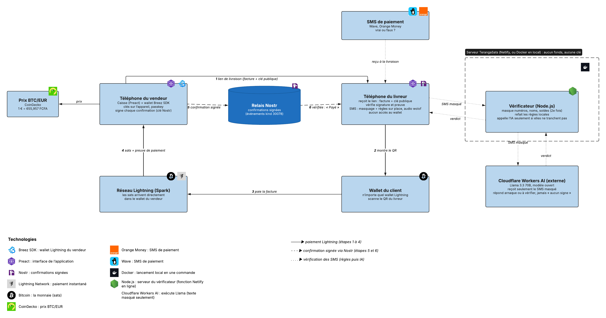

# TerangaSats

Protège les vendeurs sénégalais qui livrent à domicile contre les faux paiements.

Projet du **Dakar Bitcoin Hack #4 par BTrust**. Porteurs : Mouhamadou Moustapha Bah, Mohamed Camara.

## Le problème

À la livraison, le client montre un faux SMS « Vous avez reçu 135 000 F » et repart avec la marchandise : le livreur ne voit pas le solde du vendeur. C'est arrivé au marché Sandaga en novembre 2024, jugement à l'appui (sources dans le [dossier du projet](docs/spec-v4.html)).

## La solution

1. **Dès aujourd'hui, un vérificateur de SMS.** Des règles locales, puis un modèle ouvert (Llama 3.3 70B, via Cloudflare Workers AI) si elles ne tranchent pas. L'IA peut signaler une arnaque, jamais rassurer. Le verdict est aussi lu en wolof.
2. **Avec Bitcoin, un lien de livraison Lightning.** Le téléphone du livreur affiche « Payé » seulement après avoir vérifié la signature du vendeur et la preuve de paiement : le preimage $p$ tel que $\mathrm{SHA256}(p)$ égale le hash de la facture.

## Architecture



Source modifiable : [Lucidchart](https://lucid.app/lucidchart/66756d49-1097-4fc7-a50e-9d2e4b1a4088/edit)

- **Vendeur** : caisse Preact et wallet Lightning dans le navigateur (Breez SDK Spark, WebAssembly), ouvert par passkey. Il crée la facture avec son propre preimage, puis publie une confirmation signée (événement Nostr kind 30078) une fois payé.
- **Livreur** : reçoit le lien (facture + clé publique du vendeur), montre le QR au client, vérifie signature et preuve. Il ne charge jamais le wallet.
- **Vérificateur** : masque numéros, noms et soldes sur le téléphone puis sur le serveur, applique les règles, n'appelle l'IA que si elles ne tranchent pas.
- **Serveur** : ne détient ni fonds ni clé.

| Dossier | Contenu |
|---|---|
| `app/` | Application web : caisse, wallet Breez, lien de livraison |
| `verifier/core` | Masquage, règles, décision : code partagé par l'interface et le serveur |
| `verifier/server` | Serveur HTTP du vérificateur, appel à Cloudflare Workers AI |
| `verifier/ui` | Interface du vérificateur, sans framework, audio en wolof |
| `verifier/dataset`, `verifier/eval` | Jeu de test et mesure du vérificateur |
| `netlify/functions` | Le vérificateur en fonction Netlify (`/api/verify`) |

## Lancer en local

```bash
cp .env.example .env
docker compose up --build
```

- Application : http://localhost:8080 ; vérificateur : http://localhost:8787.
- `VITE_BREEZ_API_KEY` : clé d'API Breez (gratuite), pour le wallet réel.
- `CF_ACCOUNT_ID` et `CF_API_TOKEN` : compte Cloudflare gratuit, jeton créé avec le modèle « Workers AI » (environ 1 300 vérifications par IA et par jour). Sans eux, l'IA répond toujours « À vérifier ».
- Sans Docker : `cd verifier && npm ci && npm start`, puis `cd app && npm ci && npm run dev`.

## Mise en ligne (Netlify)

L'application et le vérificateur tournent sur Netlify, à la même adresse (`netlify.toml`).

1. Netlify → *Add new project* → *Import from GitHub* → ce dépôt.
2. Variables d'environnement : `VITE_BREEZ_API_KEY`, `CF_ACCOUNT_ID`, `CF_API_TOKEN`.
3. Déployer. La passkey est liée au domaine : choisir le nom du site avant le premier vrai paiement.

## Démo

Ouvrir l'application avec `?demo=1`, dans deux onglets (paiements simulés, sans argent ; `?demo=0` pour sortir) :

1. Onglet vendeur (`#/vendeur`) : saisir un article et un prix, « Créer le lien ».
2. Onglet livreur : ouvrir le lien.
3. « Simuler le paiement du client » → « Payé » et délai affiché.
4. « Tester un faux écran » → « Confirmation refusée ».
5. Accueil → « J'ai reçu un SMS » : coller un SMS, par exemple ceux ci-dessous.

| Expéditeur | SMS | Attendu |
|---|---|---|
| `771234567` | `Vous avez reçu 135000F. Ref 8823. Nouveau solde: 210000F` | Signes d'arnaque (règle, sans appel serveur) |
| *(vide)* | `Je me suis trompé, composez le code d'annulation #144*2*5521# svp` | Signes d'arnaque (règle) |
| `Wave` | `Paiement de 250000F effectué. Livrez la marchandise immédiatement au client.` | IA → Signes d'arnaque |
| `OrangeMoney` | `Vous avez reçu 5000F de Awa Ndiaye (771234567). Ref: CI231113.1542.A12345. Nouveau solde: 42500F` | IA → À vérifier (jamais « Aucun signe ») |

**Paiement réel (mainnet, environ 200 sats).** Le réseau de test de Breez n'a pas de Lightning. Sans `?demo=1`, dans Chrome ou Edge : « Connecter mon wallet » (passkey, ou code à 6 chiffres), créer une commande de 150 FCFA, ouvrir le lien de livraison dans un autre onglet (HTTPS ou localhost obligatoire), payer le QR depuis un wallet Lightning (Wallet of Satoshi, Blink). Ne pas vider le navigateur du vendeur avant le paiement : le preimage et le wallet y sont stockés.

## Tests

```bash
cd verifier && npm test      # masquage, règles, IA, serveur, interface
cd verifier && npm run eval  # mesure sur le jeu de test (Cloudflare requis)
cd app && npx vitest run     # lien de livraison, preuve, confirmations, écrans
cd app && npm run size       # budget : < 300 Ko gzip hors wallet
```

## Mesures

Vérificateur, sur 63 messages dont 3 SMS réels masqués ([verifier/eval/RESULTS.md](verifier/eval/RESULTS.md)) :

| | Arnaques classées « arnaque » | Arnaques classées « aucun signe » | Fausses alertes |
|---|---|---|---|
| Règles seules | 12/30 | 0 | 0 % |
| Règles + Llama 3.3 70B | 22/30 | 0 | 0 % |

Les 8 arnaques restantes sont des faux transferts identiques à de vrais reçus : elles restent « À vérifier ». Le choix de l'IA (Laya testé puis écarté, comparaison des modèles) est dans [docs/choix-ia.md](docs/choix-ia.md). Les messages sont surtout reconstitués : les chiffres sont à refaire avec plus de vrais SMS.

## Sécurité et limites assumées

- Le serveur ne détient ni fonds ni clé. Le SMS est masqué deux fois, n'est ni stocké ni journalisé ; seul le texte masqué part vers Cloudflare Workers AI.
- Le vérificateur ne dit jamais « authentique » ; au moindre doute ou en cas de panne, il répond « À vérifier ». Les paiements Wave et Orange Money ne sont pas garantis : il aide, il ne prouve pas.
- Sans passkey, le wallet est chiffré par un code à 6 chiffres (AES-GCM, PBKDF2) : une attaque hors ligne reste possible si le téléphone est volé.
- Le téléphone du vendeur doit être en ligne pour que la confirmation Lightning parte vers le livreur.

## Ensuite

- Collecter plus de vrais SMS masqués et refaire la mesure.
- Détecter le client qui présente son propre SMS d'envoi comme preuve.
- Pilote avec des vendeurs qui livrent, sortie vers le FCFA avec un partenaire local, saisie à la voix en wolof.

## Documents

- [Dossier du projet](docs/spec-v4.html) : problème, sources, conception.
- [Choix de l'IA](docs/choix-ia.md).
- [Application](app/README.md).
